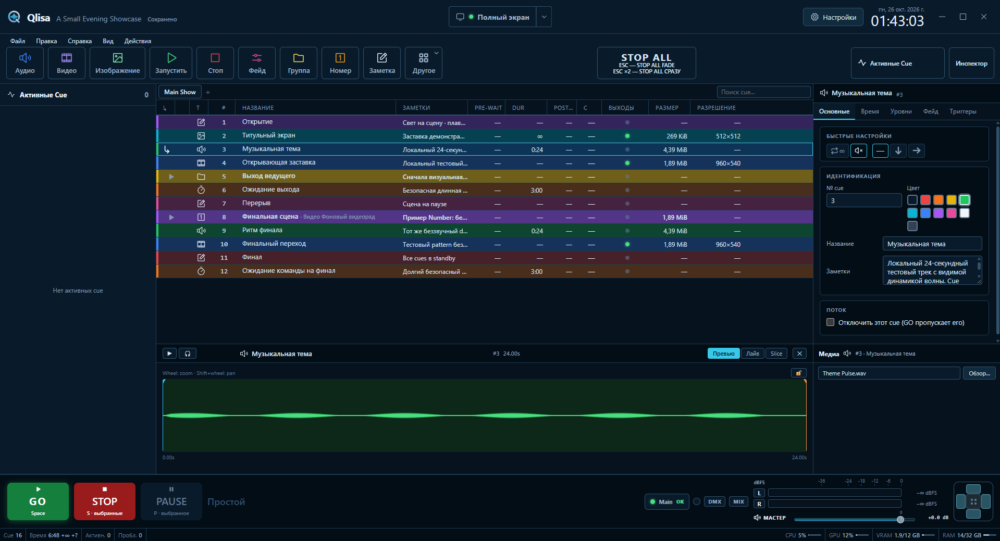
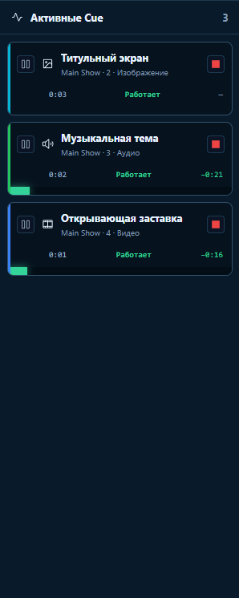
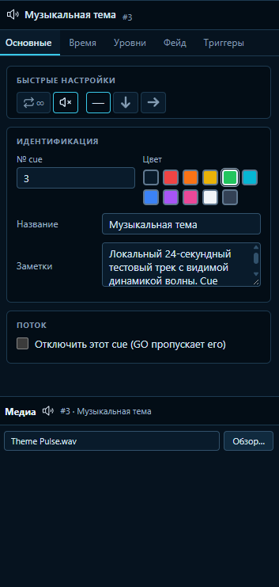

<a href="README.md">Русский</a> | <strong>English</strong>

  

  
  
  

  <a href="https://github.com/Ruslan-mad/Qlisa/releases/latest"><strong>⬇ Download Qlisa for Windows</strong></a> ·
  <a href="#screenshots">Screenshots</a> ·
  <a href="docs/README.md">Documentation</a> ·
  <a href="https://github.com/Ruslan-mad/Qlisa/issues">Report an issue</a>

# Qlisa

**Qlisa helps run audio, video, images, and other actions during concerts, theatre, presentations, and other live events.** Prepare a sequence of actions in advance, then run it with **GO** during the show.

Instead of separate players and folders full of files with confusing names, the show lives in one project. For example, one Cue can start music, the next can show a title card, and another can begin automatically after a video ends.

During a show, Qlisa can help you:

- start a music track;
- play a video or display an image and text;
- fade audio or send it to a selected device;
- start the next Cue automatically;
- send a command to other equipment or software;
- show different content on multiple displays.

## How Cue List and GO work

A **Cue** is one show action, such as playing audio, displaying video or text, waiting, changing an audio level, or sending a command to an external system. A **Cue List** is an ordered list of these actions. Use it to prepare the show and configure its media, levels, outputs, and delays.

The **Playhead** points to the Cue that will start when you press **GO**. After it starts, the Playhead moves down the list. The **Active Cues** panel shows Cues that have started and their state. **STOP** stops selected playback using its normal behavior. Use Hard Stop for an immediate stop.

You can choose how a Cue advances the list. **Auto-Continue** starts the next Cue after a set delay measured from the current action's start, so Cues can overlap. **Auto-Follow** starts the next Cue after the current action finishes and its delay elapses.

In the Cue List, **Up/Down** moves through visible rows and moves the Playhead; **Space** starts the selected Cue. Double-click a Group or Number row to expand or collapse it. **Left/Right** collapses and expands the focused Group or Number.

## Screenshots

| Active Cues | Cue Inspector |
| --- | --- |
|  |  |

## Features

### Audio, video, and images

- Play audio and video; display images and text.
- Set levels, fade in and out, trim the beginning and end, seek, and loop playback.
- Choose audio devices, mix audio, and preview through headphones.
- The editor's Play/Pause and seek controls operate the visual preview and its sound; the headphone button only mutes or unmutes the sound.
- Use multiple display outputs and route visual Cues to specific outputs.
- Set separate image geometry for different outputs.

### Cue types and show control

Available Cue types include Audio, Video, Image, Text, Memo, Wait, Fade, Stop, Group, Number, and more. Qlisa supports pre- and post-action delays, loops, control of other Cues, and groups that run actions in sequence or in parallel.

Configurable automatic transitions complement manual control through the Playhead, GO, STOP, and Active Cues panel. Waveform and media preview caches are stored alongside the project.

Qlisa 1.5.13 added UUID-based commands between Cue Lists. Goto moves the target list's Playhead while the visible tab stays unchanged. The version also updated the Media Dock, search field, and per-list timecode settings. See the [release notes](docs/RELEASE_NOTES_1.5.13.md) and [cross-list command guide](docs/cross-list-commands.md).

Qlisa 1.5.14 added a configurable status bar and restoration of the main window's position, size, and maximized state. See the [1.5.14 release notes](docs/RELEASE_NOTES_1.5.14.md), [status bar guide](docs/status-bar.md), and [window state note](docs/window-state.md).

Qlisa 1.5.19 is the current release. It fixes first-run Windows Media Runtime downloads by switching FFmpeg and ffprobe to a pinned Gyan release. [Download Qlisa 1.5.19](https://github.com/Ruslan-mad/Qlisa/releases/tag/v1.5.19); see the [1.5.19 release notes](docs/RELEASE_NOTES_1.5.19.md). The [1.5.18 release notes](docs/RELEASE_NOTES_1.5.18.md) describe the previous release.

Qlisa 1.5.12 also introduced the Stage theme for live operation, with a
compact Cue List, independently collapsible panels, and large transport
controls. See the [Stage theme notes](docs/flagship-theme.md) and [1.5.12 release notes](docs/RELEASE_NOTES_1.5.12.md).

### Connecting to other systems

Qlisa supports MIDI, OSC, Timecode, sACN, Art-Net, NDI, and SRT. A Cue can run media and send commands to compatible software or systems.

The full installer includes the official NDI 6 Runtime and runs its standard installer. The compact update package does not include or run NDI.

### Conversion and import

Built-in tools convert audio, video, and images. FFmpeg and ffprobe handle media processing and inspection. Qlisa supports importing QLab projects to transfer prepared Cue Lists.

## Installation

Qlisa is for **Windows 10 and Windows 11**. The installer installs the app for all users under `C:\Program Files\Qlisa` and may ask for administrator rights.

1. For a new or offline install, download `Qlisa_*_full-setup.exe` from the [latest release page](https://github.com/Ruslan-mad/Qlisa/releases/latest). `Qlisa_*_update-setup.exe` is for updating an installed copy.

2. Run the installer and complete setup.

3. Start Qlisa. The full installer contains the verified Media Runtime and offline WebView2 installer. If a bundled file fails verification, Qlisa stops preparation and shows an error.

The full installer also installs NDI 6 Runtime when a suitable version is missing. Compact updates preserve the runtime cache and installed NDI Runtime.

## Projects

New projects use the `.qlisa` extension. Qlisa also opens `.inkue` projects; both extensions use the same workspace structure. Keep media files in accessible locations and check their paths when moving a project to another computer.

## Updates and Media Runtime

Qlisa checks for app updates through GitHub Releases. The user starts an update from the app. Qlisa delays installation while Cues are playing.

The full installer first verifies the SHA-256 hashes of bundled FFmpeg, ffprobe, libmpv, and the Vulkan loader, then copies them to `%LOCALAPPDATA%\Qlisa\runtime`. This allows setup to start without a network connection. The compact update package omits these large components and preserves the existing cache. If runtime files are missing or damaged, Qlisa verifies pinned upstream archives and downloads the required files. A verification or download error keeps the main window closed.

See [Windows Media Runtime](docs/windows-network-runtime.md) for details.

## Project status

Qlisa is actively developed. The interface is available in Russian and English. Windows 10 and Windows 11 are the primary release platforms. Official releases for macOS and Linux are not available. Report bugs and suggest improvements in [GitHub Issues](https://github.com/Ruslan-mad/Qlisa/issues).

## Development

To build Qlisa, you need Windows 10 or 11, Rust stable, Node.js, pnpm, Tauri 2 prerequisites, Visual Studio C++ Build Tools, and the Windows SDK. See the [developer guide](docs/PROJECT_GUIDE.md) for setup, build instructions, and project details.

## Inkue project

Qlisa is based on the open-source project [Inkue by FonograF](https://github.com/FonograF/Inkue). We thank the author and Inkue contributors for the original project.

## License

Qlisa is licensed under [GPL-3.0-or-later](LICENSE). Third-party components have separate licenses and notices: [THIRD_PARTY_NOTICES.md](THIRD_PARTY_NOTICES.md).

## Documentation

Technical guides in docs are currently in English; the 1.5.11 and 1.5.12 release notes are available in English and Russian. Manual checks are listed in the [regression checklist](docs/BUGFIXES_NEXT.md).

- [Qlisa documentation](docs/README.md)
- [Developer guide](docs/PROJECT_GUIDE.md)
- [Output Monitor: packet format and preliminary WebView measurements](docs/output-monitor.md)
- [Release preparation](docs/RELEASING.md)
- [Version 1.5.11 release notes](docs/RELEASE_NOTES_1.5.11.md)
- [Version 1.5.12 release notes](docs/RELEASE_NOTES_1.5.12.md)
- [Follow-up regression checklist](docs/BUGFIXES_NEXT.md)
- [License](LICENSE) · [Third-party notices](THIRD_PARTY_NOTICES.md)
